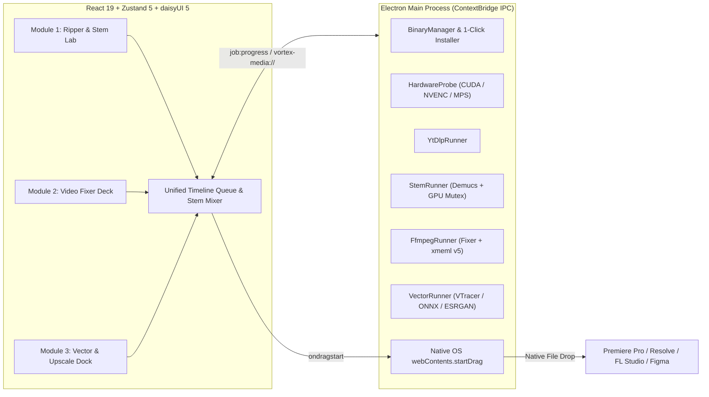

<div align="center">

# ⚡ VORTEX — CreatorVault

**The Local-First Creator Media Engine**  
*Stacher7 meets Raycast for Video Editors, Music Producers, and Motion Designers*

[](https://github.com/pranzzzhu/CreatorVault/releases)
[](https://www.electronjs.org/)
[](https://react.dev/)
[](https://www.typescriptlang.org/)
[](https://tailwindcss.com/)
[](https://developer.nvidia.com/cuda-zone)
[](./LICENSE)
[](./CHANGELOG.md)

</div>

---

## Overview

**VORTEX (`CreatorVault`)** is a local-first desktop media engine that wraps the industry's most powerful command-line media and AI utilities—`yt-dlp`, `FFmpeg`, `Demucs`, `VTracer`, `U2Net (ONNX)`, and `Real-ESRGAN`—into a zero-terminal, high-contrast dark interface built for NLE workflows.

Every completed clip, isolated audio stem, Premiere Pro XML timeline, SVG vector trace, and 32-bit transparent PNG alpha matte renders as an interactive pill that you can **drag and drop directly out of the VORTEX window** onto an open **Adobe Premiere Pro, After Effects, DaVinci Resolve, FL Studio, or Figma** canvas.

---

## Core Modules

### 1. 📥 Universal Ripper, Clipper & Stem Lab (Module 1)
- **Instant URL Probe (`<1.2s`):** Press `Ctrl+V` anywhere to inspect YouTube, Instagram, TikTok, X/Twitter, SoundCloud, Vimeo, or Twitch streams via `yt-dlp --dump-single-json`.
- **Visual Section Clipper:** Dual-handle timeline range slider (`MM:SS`) that downloads *only* the exact In/Out window (`--download-sections` + `--force-keyframes-at-cuts`) instead of pulling multi-hour VODs.
- **NLE Edit-Ready Mode:** Enforces Premiere/Resolve-safe containers (`H.264/AAC .mp4` via `--remux-video mp4` and uncompressed `48kHz 16-bit PCM .wav`) to eliminate `.webm` VP9/AV1 import errors and VFR audio drift.
- **Local AI Stem Separation (`Demucs`):** Splits any clip or audio track into **2 Stems** (`Vocals / Speech.wav` + `Instrumental / BGM.wav`) or **4 Studio Stems** (`Vocals.wav`, `Drums.wav`, `Bass.wav`, `Instrumental.wav`) on GPU/CPU with an in-app **Synchronized Multi-Track Stem Mixer** (Solo / Mute / `<35ms` phase lock).
- **Browser Cookie Bypass:** Optional 1-click `--cookies-from-browser` pass-through (`Chrome`, `Brave`, `Edge`, `Firefox`) for age-restricted or member-only streams.

### 2. 🎞️ FFmpeg Video Fixer & Proxy Deck (Module 2)
Drop local camera footage (`.mp4`, `.mov`, `.mkv`, `.mxf`, `.webm`) to probe stream metadata via `ffprobe` and run five specialized pipelines:
- **Social Compression Armor & IG Reel Optimizer (`reel-optimizer`):** Pre-compensates for aggressive platform re-compression across Instagram Reels, TikTok, and YouTube Shorts. Applies 1080×1920 9:16 Lanczos scaling with centering, temporal grain denoising (`hqdn3d`), unsharp pre-emphasis (`unsharp=3:3:0.5|0.85`), CFR lock (`fps=30|60`), broadcast master `libx264` encoding (slow preset, CRF 18, 12M maxrate, tuned AQ mode and GOP keyint lock), Rec.709 color space lock (`bt709 tv`, SDR sources only), and EBU R128 audio normalization (`loudnorm=I=-14:TP=-1.0`, skipped on silent clips). Optional constrained platform upload simulator scores both the raw and armored uploads against the original source with VMAF (SSIM fallback); no badge is shown if neither metric is available.
- **LED Deflicker & De-Band:** Eliminates high-shutter rolling banding and PWM studio lighting flicker using temporal predictive-mean filtering (`deflicker=mode=pm:size=5|7|11,gradfun=strength=1.2:radius=8`).
- **Exact Target Size Compressor (`8MB`–`100MB`):** Solves exact video/audio bitrates from `ffprobe` duration (`(targetMB * 8192 * 0.94) / duration - 128`) using `h264_nvenc` VBR or isolated 2-pass `libx264` so exports always fit Discord, WhatsApp, or client review caps.
- **Dead-Air Silence Chopper $\rightarrow$ Premiere XML:** Scans dialogue via `silencedetect` and exports both a non-destructive Final Cut Pro 7 / Premiere Pro / DaVinci Resolve `xmeml version="5"` `.xml` cut list (with NTSC fractional frame-rate detection) and a jump-cut preview `.mp4`.
- **Instant ProRes 422 Proxy Deck:** Transcodes heavy HEVC/VFR drone or action-cam footage into scrub-friendly `1080p Apple ProRes 422 Proxy (.mov)` (`prores_ks -profile:v 0 -pix_fmt yuv422p10le`) with `48kHz PCM` audio.

### 3. ✒️ Vectorizer, Background & Upscale Dock (Module 3)
Drop raster assets (`.png`, `.jpg`, `.webp`, `.bmp`) and inspect results side-by-side in the **Before / After Visual Inspector**:
- **Raster-to-SVG Vectorizer (`VTracer`):** Converts logos, icons, typography, and sketches into editable multi-color or monochrome Bézier spline `.svg` vector paths (`vtracer 0.6.15` Rust engine).
- **Studio Background Remover (`U2Net ONNX`):** Extracts subjects from portraits, thumbnails, and product shots into a 32-bit transparent `.png` alpha matte in ~1.5 seconds via `onnxruntime` (`u2net.onnx`), with adjustable edge tolerance and an automatic FFmpeg perimeter `colorkey` fallback.
- **Super-Resolution Asset Upscaler (`Real-ESRGAN`):** Restores low-resolution textures and archival stills at **2x** or **4x** scale using `RealESRGAN_x4plus.pth` neural weights via PyTorch `spandrel` (with `384×384` tiled inference to prevent VRAM spikes) or `realesrgan-ncnn-vulkan`.

---

## System Architecture



### 7 Managed Sidecar Engines & 1-Click Installer
VORTEX automatically scans `./bin`, system `PATH`, and WinGet packages on launch. Any missing engine or AI model weight can be installed directly inside **Settings $\rightarrow$ Sidecar Binaries** with a single click:

| Sidecar Binary | Role | Provisioning Source |
| :--- | :--- | :--- |
| **`yt-dlp`** | Stream extraction & timestamp section clipping | PyPI (`pip install -U yt-dlp`) |
| **`ffmpeg`** | H.264/ProRes encoding, deflicker, silence chopper & WAV normalization | WinGet (`Gyan.FFmpeg`) / Homebrew |
| **`ffprobe`** | Container duration, resolution, codec & VFR/NTSC framerate inspection | WinGet (`Gyan.FFmpeg`) / Homebrew |
| **`demucs`** | 2-stem & 4-stem `htdemucs` AI audio source separation | PyPI (`demucs`) |
| **`rembg` (`u2net.onnx`)** | Local ONNX neural subject segmentation & 32-bit alpha matting | PyPI (`onnxruntime`) + Hugging Face CDN |
| **`vtracer`** | Rust spline raster-to-SVG Bézier vectorization | PyPI (`vtracer`) |
| **`realesrgan`** | 2x/4x `RealESRGAN_x4plus.pth` super-resolution upscaling | PyPI (`spandrel`) + Hugging Face CDN |

---

## Project Structure

```text
CreatorVault/
├── electron/
│   ├── main.ts                        # BrowserWindow, IPC handlers, vortex-media:// protocol & startDrag
│   ├── preload.ts                     # Secure ContextBridge API & webUtils.getPathForFile
│   └── services/
│       ├── BinaryManager.ts           # Discovers & 1-click installs all 7 sidecar binaries/models
│       ├── HardwareProbe.ts           # Detects NVIDIA CUDA, NVENC, and Apple Silicon MPS
│       ├── YtDlpRunner.ts             # URL probing, section clipping & JSON progress parser
│       ├── FfmpegRunner.ts            # WAV extraction, video probing, Phase 2 Fixer & Premiere XML
│       ├── StemRunner.ts              # Demucs AI stem separation with serial GPU mutex
│       └── VectorRunner.ts            # Phase 3 VTracer SVG, U2Net ONNX & Real-ESRGAN runner
├── src/
│   ├── components/
│   │   ├── layout/
│   │   │   ├── SidebarRail.tsx        # Workspace navigation, hardware telemetry & zoom controls
│   │   │   └── DiagnosticsPanel.tsx   # Settings modal with 1-Click Sidecar Installer & theme switcher
│   │   ├── ripper/
│   │   │   ├── UrlCommandBar.tsx      # Global Ctrl+V listener & URL command bar
│   │   │   ├── StagingCard.tsx        # Stream quality selector, trim range & stem split controls
│   │   │   ├── TimeRangeSlider.tsx    # Dual-handle visual In/Out timestamp trimmer
│   │   │   └── JobQueueList.tsx       # Live progress cards, draggable NLE pills & Stem Audio Mixer
│   │   ├── fixer/
│   │   │   └── FixerModuleView.tsx    # Phase 2 video dropzone, 5 fixer presets & parameter controls
│   │   └── vectorizer/
│   │       └── VectorizerModuleView.tsx # Phase 3 image dropzone, 3 AI tools & Before/After Inspector
│   ├── store/
│   │   └── useJobStore.ts             # Zustand state store & sequential batch job queues
│   ├── types/
│   │   └── media.ts                   # Shared TypeScript contracts across Main & Renderer
│   ├── App.tsx
│   ├── main.tsx
│   └── index.css                      # Tailwind CSS 4 + daisyUI 5 custom obsidian & slate themes
├── creator_vault_product_architecture_specification.md
├── THIRD_PARTY_LICENSES.md
├── LICENSE
└── package.json
```

---

## Getting Started

### Prerequisites
- **Node.js** `>= 20.x`
- **Python** `>= 3.10` (for 1-click sidecar installation of `yt-dlp`, `demucs`, `vtracer`, `onnxruntime`, and `spandrel`)
- **FFmpeg** (automatically detected from `PATH` or WinGet, or installable in 1 click from the in-app Settings modal)

### Installation & Development

```bash
# 1. Clone the repository
git clone https://github.com/pranzzzhu/CreatorVault.git
cd CreatorVault

# 2. Install dependencies
npm install

# 3. Launch VORTEX in development mode (Vite + Electron HMR)
npm run dev
```

### Installing Sidecar Binaries & AI Models
1. Launch VORTEX and click **Settings** (bottom-left of the sidebar rail).
2. Under **Sidecar Binaries (`./bin` & System `PATH`)**, click **Install** next to any missing engine (`yt-dlp`, `ffmpeg`, `demucs`, `rembg`, `vtracer`, `realesrgan`).
3. VORTEX automatically downloads the packages and model weights (`u2net.onnx` and `RealESRGAN_x4plus.pth`) and switches the status badge to **All ready**.

### Type-Checking & Production Build

```bash
# Run full TypeScript verification
npx tsc --noEmit

# Build production renderer & Electron bundles
npm run build

# Package Windows standalone distribution (release/win-unpacked/Vortex.exe)
npm run dist:win
```

---

## License & Attributions

- **VORTEX (`CreatorVault`)** is licensed under the [MIT License](./LICENSE).
- Sidecar command-line utilities and pretrained model weights are governed by their respective open-source licenses. See [`THIRD_PARTY_LICENSES.md`](./THIRD_PARTY_LICENSES.md) for full attribution details.
