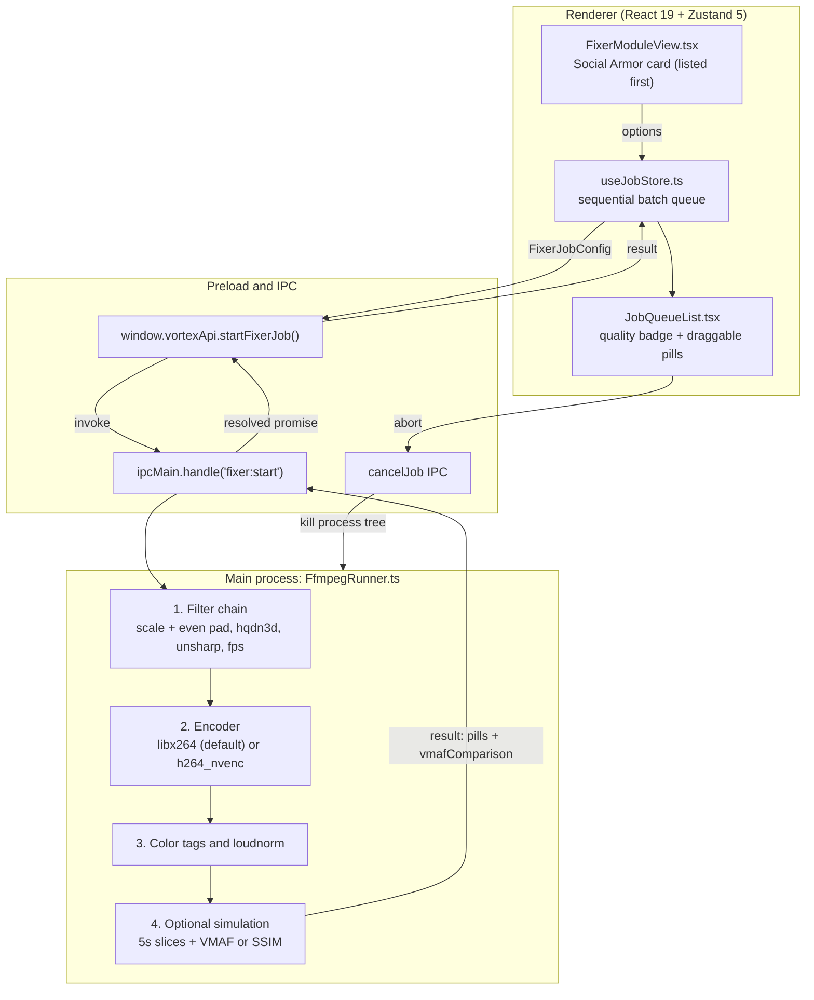

# Social Compression Armor & IG Reel Optimizer (`reel-optimizer`)

*   **Author:** VORTEX Desktop Systems Team
*   **Status:** Remediated after EGM review of 2026-11-08
*   **Date:** 2026-11-08

---

## Overview

Instagram Reels, TikTok, and YouTube Shorts re-encode uploads at roughly 3.5 Mbps. High-bitrate camera footage carries high-frequency detail and sensor noise that use up that bitrate budget. The result is quantization artifacts (such as macroblocking), gamma shifts, and softened edges.

`reel-optimizer` is the fifth pipeline in Module 2 (FFmpeg Video Fixer & Proxy Deck), shown first in the preset list. It conditions footage before upload: 1080×1920 Lanczos scaling with even-aligned padding, temporal denoising, unsharp pre-emphasis, constant frame rate (CFR), a high-bitrate H.264 master with scene-cut keyframes, Rec.709 tagging, and loudness normalization. An optional simulator re-encodes a 5-second slice at platform-like settings and scores the result against the original footage.

---

## The Problem

1. **High-Frequency Noise Overhead**: Platform encoders cannot spend bits on both fine detail and grain, so they quantize aggressively in shadows and skin tones, causing macroblocking and gradient banding.
2. **Platform Softening**: Re-compression blurs high-contrast textures (eyes, hair, text).
3. **Color Space Drift**: Untagged streams make mobile players assume BT.601 or a wrong transfer curve, producing washed-out contrast.
4. **VFR Stutter**: Variable frame rate phone footage causes dropped frames and audio desync when platforms re-encode it.
5. **No Local Preview**: Creators cannot preview platform degradation before upload.

---

## Goals

*   **9:16 Framing**: Scale to 1080×1920 with Lanczos and centered letterbox or pillarbox padding. Scaled size and pad offsets must be even so YUV420p chroma planes stay aligned.
*   **Temporal Denoising**: Optional `hqdn3d` pass (Grain Saver) to reduce bitrate spent on noise.
*   **Edge Pre-Emphasis**: Optional `unsharp` pass (Subtle or Crisp) to offset platform softening.
*   **Constant Frame Rate**: Always output CFR. `30` and `60` force that rate; `Source` locks to the probed input rate.
*   **High-Bitrate Master**: Software `libx264` by default (CRF 18, 12 Mbps cap, AQ mode 3, keyframe every 2 seconds with scene-cut detection on). NVENC is an optional speed-up through the Hardware toggle.
*   **Rec.709 Tagging**: Optional bt709 color metadata for SDR sources.
*   **Loudness Normalization**: Target −14 LUFS with AAC 320 kbps at 48 kHz. Skip normalization for clips under 3 seconds. Omit audio entirely when the input has no audio stream.
*   **Constrained Upload Simulation (optional)**: Re-encode a 5-second middle slice of the raw upload and of the armored master at 3.5 Mbps, then score both against the original source. The simulation never blocks the master: any non-cancellation failure leaves the master delivered without a quality badge.

---

## Non-Goals

*   **Direct Platform Publishing**: No upload or publishing API. Files export locally.
*   **Facial AI Enhancement**: No facial smoothing or generative filters.
*   **Timeline Video Editing**: No multi-track editing (cutting, splicing, transitions).
*   **HDR Tone-Mapping**: The Rec.709 lock tags metadata only. It applies to SDR sources. HDR, HLG, and BT.2020 footage must be tone-mapped in the NLE first.
*   **Per-Platform Encoding Profiles**: The Platform selector (`ig-reels`, `tiktok`, `yt-shorts`) changes only the output file name tag. All platforms share one encoding profile.

---

## Critical User Journeys (CUJs)

### CUJ 1: Creator Conditions a 4K Landscape Clip for Instagram Reels

*   **Given**: A 4K 16:9 60 fps camera clip with high ISO grain is on disk.
*   **When**: The user drops it into Module 2, selects **Social Compression Armor**, sets Platform to `IG Reels` and Pre-Sharpen to `Subtle`, enables Grain Saver and Rec.709 Lock, and clicks **Run Fixer**.
*   **Then**: FFmpeg outputs a 1080×1920 master with black bars, denoised and sharpened, with a keyframe every 2 seconds and audio normalized to −14 LUFS. When the simulation produces scores, the job card shows a quality badge, for example `Raw Upload: 76.4 -> Armored: 92.1 (+15.7 Lift)` (illustrative values).

### CUJ 2: User Previews a Constrained Platform Transcode

*   **Given**: A `reel-optimizer` job with simulation enabled is running.
*   **When**: The job completes and the user views the job card in `JobQueueList`.
*   **Then**: The card shows the master file pill (`IG_Reel_Armored.mp4`) and the simulated transcode pill (`Simulated_IG_Constrained.mp4`). Each pill is a draggable file proxy: dragging it onto the desktop or an NLE timeline copies the file (Electron native drag-and-drop). The quality badge appears only when scores exist.

### CUJ 3: Metric Fallback Without `libvmaf`

*   **Given**: The FFmpeg binary lacks `libvmaf` or its model file.
*   **When**: A job runs with simulation enabled.
*   **Then**: The runner probes the filter list, falls back to `ssim`, converts it to a 0–100 score with `clamp(ssim × 100, 20, 99)`, and completes. If neither filter works, scores are `null`, the preview pill still ships, and no badge is shown. No placeholder or estimated scores are ever reported.

### CUJ 4: Silent Clip

*   **Given**: A drone or timelapse clip has no audio stream.
*   **When**: The user runs the preset.
*   **Then**: The runner detects the missing stream, omits loudness normalization and AAC encoding (`-an`), and the master encodes without error.

### CUJ 5: Abort During Simulation

*   **Given**: A job is in the simulation or scoring step.
*   **When**: The user clicks Abort.
*   **Then**: The FFmpeg process tree is killed, the cancellation error propagates through the scoring and simulation steps, and the job ends as cancelled, not completed.

---

## Technical Plan (Architecture)



### Architectural Subsections

1.  **Renderer View (`FixerModuleView.tsx`)**: Shows the Social Compression Armor card with controls for platform tag, frame rate, pre-sharpen, Grain Saver, Rec.709 Lock, and IG Simulation. Controls render only when `selectedFixerPreset === 'reel-optimizer'`.
2.  **State Store (`useJobStore.ts`)**: Runs batch jobs one at a time in first-in, first-out order so consumer GPUs stay under hardware-encoder session limits. Clears staged videos immediately on enqueue so repeated clicks cannot submit duplicates. Stores `vmafComparison` on the completed job.
3.  **IPC Bridge (`preload.ts`, `main.ts`)**: Sends `FixerJobConfig` over context-isolated IPC, streams progress events, and returns the output path, pills, and optional `vmafComparison`.
4.  **FFmpeg Runner (`FfmpegRunner.ts`)**: Builds the filter chain and encoder arguments, caps threads, drains stdout, and propagates cancellation.

---

## Risks & Mitigations

| Risk | Impact | Mitigation |
| :--- | :--- | :--- |
| **Swallowed Cancellation** | Abort during simulation or scoring marks the job completed. | Every `catch` in the simulation and scoring path re-throws errors that match `/cancel/i`. |
| **Missing VMAF Model** | `libvmaf` fails without its model file. | Probe the filter list, then fall back to `ssim`, then to no score. |
| **CPU Starvation** | `libx264 -preset slow` on 4K clips uses every core. | `-threads Math.max(1, Math.min(os.cpus().length - 2, 8))`. |
| **Chroma Misalignment** | Odd pad offsets break YUV420p chroma planes. | Even scale size and `trunc((ow-iw)/4)*2` pad offsets. |
| **Silent Input** | `loudnorm` aborts when no audio stream exists. | Detect audio streams first; use `-an` when none exist. |
| **VFR Input** | Variable frame rate survives when no `fps` filter is set. | `Source` rate locks to the probed frame rate with `fps=<probed>`. |
| **HDR Input** | bt709 tags on HDR pixels give blown-out color. | Documented as SDR only (Non-Goals); tooltip warns the user. |
| **Windows Pipe Stall** | Unread stdout above 64 KB hangs a child process. | `proc.stdout?.resume()` in every spawn wrapper. |
| **Skewed Metric** | Scoring against a processed master inflates retention. | Both slices are scored against the original source; no score offsets are added. |

---

## Alternatives Considered

### Alternative A: NVENC by Default

*   **Pros**: Higher encoding throughput on supported GPUs.
*   **Cons**: NVENC shows more macroblocking and rate overshoot at low bitrates than `libx264 -preset slow` with tuned AQ.
*   **Decision**: Default to software `libx264` for maximum quality retention. NVENC is selectable through the Hardware toggle.

### Alternative B: SSIM Only

*   **Pros**: The `ssim` filter needs no model file.
*   **Cons**: SSIM models temporal human perception less accurately than VMAF.
*   **Decision**: Probe for `libvmaf` first. Fall back to `ssim` when it is unavailable.

### Alternative C: Remove the Simulator and the Platform Selector

*   **Pros**: About 150 fewer lines and fewer UI controls.
*   **Cons**: Drops the local preview that CUJ 2 describes.
*   **Decision**: Keep the simulator as an optional step that never blocks the master. Keep the Platform selector as a file-name tag only. Revisit both if they see no use.

---

## Open Questions

*   Should Instagram Story bitrates, which are lower than Reels, get a separate profile?
*   Should AV1 or HEVC export be offered for platforms that accept it, such as YouTube Shorts?

---

## Detailed Implementation Plan

### Phase 1: Shared Types (`src/types/media.ts`)

Checkpoint: `npx tsc --noEmit` reports 0 errors.

*   Add `'reel-optimizer'` to `FixerPresetId`. Export `type FixerPreset = FixerPresetId;`.
*   Add:
    ```typescript
    export interface ReelOptimizerOptions {
      platform: 'ig-reels' | 'tiktok' | 'yt-shorts';
      targetFps: 'keep' | '30' | '60';
      preSharpen: 'none' | 'subtle' | 'crisp';
      denoiseGrain: boolean;
      colorFixRec709: boolean;
      simulateIgCompression: boolean;
    }
    ```
*   Add `reelOptimizer?: ReelOptimizerOptions` to `FixerJobConfig`.
*   Add `vmafComparison?: { rawScore: number; optimizedScore: number; simulatedPreviewPath?: string }` to `JobItem` and to the `startFixerJob` return type.

### Phase 2: Engine (`electron/services/FfmpegRunner.ts`)

Checkpoint: `npx tsc --noEmit` passes, and a manual run on a landscape clip, a silent clip, and a cancelled run behaves as in CUJ 1, 4, and 5.

*   **Filter order** (join with `,`):
    1. `scale=w='trunc(min(1080,iw*1920/ih)/2)*2':h='trunc(min(1920,ih*1080/iw)/2)*2':flags=lanczos,pad=1080:1920:'trunc((ow-iw)/4)*2':'trunc((oh-ih)/4)*2':black`
    2. If `denoiseGrain`: `hqdn3d=1.5:1.5:3:3`
    3. If `preSharpen === 'subtle'`: `unsharp=3:3:0.5:3:3:0.0`. If `'crisp'`: `unsharp=3:3:0.85:3:3:0.0`.
    4. `fps=30`, `fps=60`, or for `'keep'`: `fps=<probed fps>` when the probed value is greater than 0.
*   **Keyframe interval**: `keyint = Math.max(24, Math.round(fps * 2))`, where `fps` is the target rate or the probed rate (30 if unknown). Do not set `min-keyint`, so scene-cut detection stays on.
*   **Encoder arguments** (first match wins):
    1. `useHardwareEncoder && hasNvenc`: `-c:v h264_nvenc -preset p5 -rc:v vbr -cq 18 -b:v 0 -maxrate 12M -bufsize 24M -g <keyint> -pix_fmt yuv420p -movflags +faststart`
    2. `libx264` available: `-c:v libx264 -preset slow -profile:v high -level:v 4.2 -crf 18 -maxrate 12M -bufsize 24M -x264-params aq-mode=3:aq-strength=0.9:deblock=-1,-1:rc-lookahead=<min(60, keyint)>:keyint=<keyint> -threads <clamped> -pix_fmt yuv420p -movflags +faststart`
    3. Otherwise: `-c:v h264 -crf 18 -pix_fmt yuv420p -movflags +faststart`
*   **Color tags** (when `colorFixRec709`): `-colorspace bt709 -color_primaries bt709 -color_trc bt709 -color_range tv`.
*   **Audio**: no audio stream (`ffmpeg -i` lists no `Audio:` stream) → `-an`. Duration under 3 seconds → `-c:a aac -b:a 320k -ar 48000`. Otherwise → `-af loudnorm=I=-14:TP=-1.0:LRA=11 -c:a aac -b:a 320k -ar 48000`.
*   **Simulation** `runIgCompressionSimulation(jobId, rawInputPath, armoredOutputPath, jobFolder, baseName, durationSec, onProgress)`, returning `{ rawScore: number | null; optimizedScore: number | null; simulatedPreviewPath?: string }`:
    *   `sliceDur = min(5, max(1, durationSec))`, `sliceStart = max(0, (durationSec - sliceDur) / 2)`.
    *   Encode the armored slice and the raw slice (raw scaled with the same scale and pad filter) with `-c:v libx264 -preset fast -crf 25 -maxrate 3.5M -bufsize 7M -pix_fmt yuv420p`. Use `h264` if `libx264` is missing. Delete the temporary raw slice in a `finally` block.
    *   Score each compressed slice against the original source: `[1:v]<scale+pad filter>[ref];[0:v][ref]libvmaf` or `...ssim`. Parse `/VMAF score:\s*([0-9.]+)/i` and `/SSIM.*?All:([0-9.]+)/i`. SSIM score = `clamp(ssim × 100, 20, 99)`.
    *   Return `null` for a score when no metric filter works. Never add offsets or placeholder values.
*   **Result assembly**: build `vmafComparison` only when both scores are non-null. Add the `fixer_sim_preview` pill (`Simulated_IG_Constrained.mp4`) whenever the preview file exists.
*   **Cancellation**: every `catch` in the simulation and scoring path re-throws errors that match `/cancel/i` before any fallback.
*   **Pipes**: call `proc.stdout?.resume()` in every spawn wrapper, including `extractOrNormalizeWav` and `detectSpeechSegments`.

### Phase 3: State and Controls (`src/store/useJobStore.ts`, `src/components/fixer/FixerModuleView.tsx`)

Checkpoint: `npx tsc --noEmit` passes, and the card renders with correct defaults.

*   Store defaults: `reelPlatform: 'ig-reels'`, `reelTargetFps: 'keep'`, `reelPreSharpen: 'subtle'`, `reelDenoiseGrain: true`, `reelColorFixRec709: true`, `reelSimulateIgCompression: true`. Default `selectedFixerPreset: 'reel-optimizer'`.
*   `presetBadgeMap['reel-optimizer'] = '1080p'`. Pass `reelOptimizer` in `FixerJobConfig`. Store `result.vmafComparison` on the completed job.
*   Job title format: `[REEL-OPTIMIZER] <fileName>`.
*   Join controls (label → value): Platform `IG Reels`→`ig-reels`, `TikTok`→`tiktok`, `Shorts`→`yt-shorts`. FPS `Source`→`keep`, `30`→`30`, `60`→`60`. Pre-Sharpen `None`→`none`, `Subtle`→`subtle`, `Crisp`→`crisp`. Toggles: Grain Saver, Rec.709 Lock (tooltip: SDR only), IG Simulation.

### Phase 4: Queue Badge and Docs (`src/components/ripper/JobQueueList.tsx`, `README.md`, `HANDOVER.md`)

Checkpoint: `npm run build` passes.

*   Render the emerald quality badge only when `job.vmafComparison` exists: `Raw Upload: <raw> -> Armored: <opt> (+<delta> Lift)`.
*   `README.md`: the Module 2 bullet list (fifth pipeline) and the `FixerModuleView.tsx` line in the project tree.
*   `HANDOVER.md`: the Module 2 preset entry.

---

## Verification Plan

*   **Build**: `npx tsc --noEmit` and `npm run build` pass with 0 errors.
*   **Capability probe**: `ffmpeg -hide_banner -filters` and `-encoders` confirm `libvmaf`, `ssim`, and `libx264` availability.
*   **Geometry**: a 1920×1080 input yields a 1080×1920 output; pad offsets are even.
*   **Silent clip**: a clip without audio completes with `-an`.
*   **Short clip**: a clip under 3 seconds completes without `loudnorm`.
*   **Frame rate**: a VFR phone clip with `Source` selected outputs CFR.
*   **Metrics**: with `libvmaf`, scores come from VMAF; without it, from SSIM; with neither, no badge appears and the preview pill still ships.
*   **Cancellation**: Abort during the simulation and during scoring ends the job as cancelled.
*   **Drag-and-drop**: `vortex-media://local/` streaming and native drag work for the master and the simulated preview pills.
*   **Known gap**: the repository has no automated test runner, so these checks are manual. Add unit tests for filter assembly, `keyint` math, and cancellation propagation if a runner (for example Vitest) is introduced.
